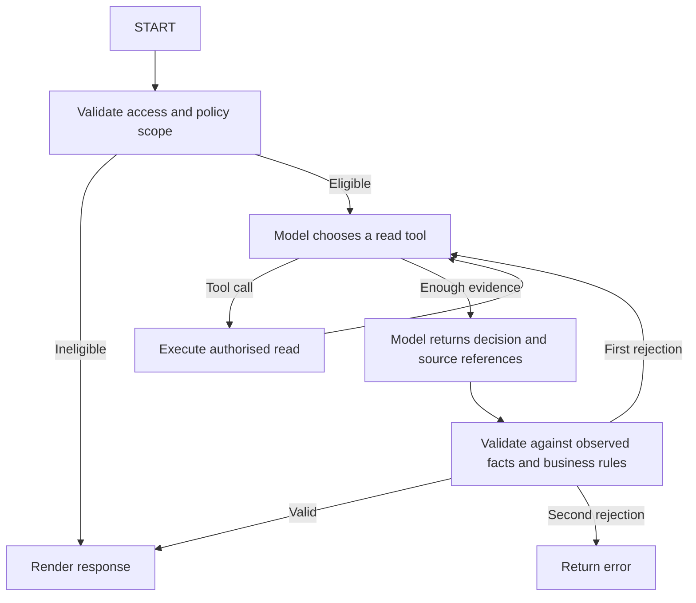

# Read-only assessment flow

Run instructions are in [README](../README.md). This graph assesses one synthetic
case and returns a recommendation; it cannot submit a business action.

## Workflow

## Responsibilities

| Code | Responsibility |
| --- | --- |
| `graph/state.py` | Messages, collected evidence, retrieved rules, trace, counters, and result |
| `graph/nodes.py` | Preflight, model/tool turns, validation feedback, and finalisation |
| `graph/builder.py` | Graph wiring and named routing functions |
| `tools.py` | Authorised reads bound to the current seller/order; definitions built once |
| `fixtures.py` | Synthetic records, scenario overrides, and simulated transient failures |
| `assessment.py` | Deterministic eligibility, model validation, and final response assembly |
| `models.py` | Typed inputs, evidence, eligibility, and outputs |
| `llm.py` | SSO-only Bedrock setup and the two model bindings |
| `__main__.py` | Configuration, graph invocation, and terminal output |

Runtime model/client instances stay outside graph state. All collected assessment
facts, retrieved rules, trace, and counters are stored in graph state. There is
no checkpointer or resume support yet.

## Model output and validation

The model chooses `get_order`, `get_resolution_history`, `get_tracking`, and
`retrieve_policy`. Final model output has only three fields:

- `decision`
- `evidence_refs`
- `policy_rule_ids`

Python validates the decision and sources, then derives the action and approval
requirement and renders the final response. No-action decisions have a null
proposal and `approval_required=false`.

The sole instruction source is `instructions/seller-support-agent.md`. At
finalisation the graph adds available evidence references and retrieved rule IDs
as runtime context. Evaluation answers and engineering docs never enter context.

Validation allows one model correction. A second invalid assessment returns an
error rather than bypassing the checks. Limits are eight tool-selection turns,
sixteen tool calls, and two structured-assessment calls. Transient fixture reads
and Bedrock SDK requests each allow one retry. Read caching is intentionally
omitted; repeated tool requests are bounded by the graph limits.

## Retrieval and authentication

Retrieval searches rule chunks from three allowlisted business-policy documents,
filtered by market and effective date. It returns up to three chunks per query.
This small corpus has one current file per document, not a policy version archive.

Bedrock uses the required SSO profile in `AWS_PROFILE`, the model/inference profile
in `BEDROCK_MODEL_ID`, and boto3's region resolution (`AWS_DEFAULT_REGION` or the
profile region). The SDK handles temporary credentials. Non-SSO providers are
rejected. Models requiring an inference profile must use that profile's ID rather
than the base model ID. Streaming is disabled; inference needs `bedrock:InvokeModel`.

The CLI prints service error codes/messages for AWS failures without dumping the
full response. Unexpected programming errors retain their traceback. `--trace`
prints workflow events and preserves the last completed state if a provider call
fails. These are diagnostics, not a persisted business audit trail.

## Verification and remaining work

Offline tests cover the twelve case/outcome pairs, access denial, policy scope,
rule precedence, invalid decisions/references, actual Bedrock schema conversion,
loop limits, correction limits, and graph-state evidence. They use scripted models
and a stubbed SDK client; they do not measure live model quality.

Still unimplemented: real seller login, persisted active-case reuse, approval
interrupts, business writes/idempotency, audit storage, checkpoint resumption,
and the UI. No refund execution, messaging, or image analysis is included.
